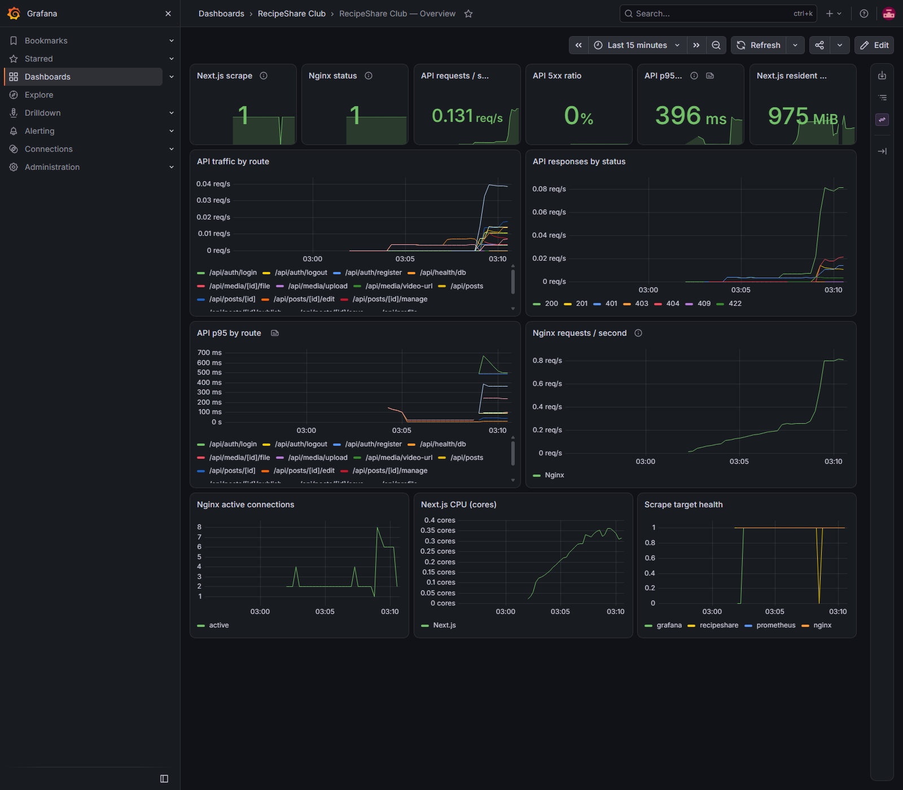

# Prometheus và Grafana

Các lệnh bên dưới mô tả cấu hình nền. Với toàn bộ ứng dụng chạy Docker, dùng [hướng dẫn production](docker-production.md) và file env tương ứng. Loki nhận log Nginx từ Promtail và log Next.js từ Alloy; xem [thu gom và truy vấn log](logging.md).

## Khởi chạy

```powershell
powershell -NoProfile -ExecutionPolicy Bypass -File scripts/init-local.ps1
docker compose config --quiet
docker compose up -d --wait
```

Trong terminal riêng, chạy `pnpm.cmd dev --hostname 0.0.0.0 --port 3000` từ `app/` như trước. Nếu dev server không nhận biến môi trường vừa thêm, khởi động lại terminal Next.js.

- Ứng dụng: http://localhost:8080
- Dashboard: http://localhost:3002/d/recipeshare-overview
- Dashboard MySQL/container: http://localhost:3002/d/recipeshare-infrastructure — [hướng dẫn nguồn số liệu và quyền collector](infrastructure-monitoring.md).
- Prometheus targets: http://localhost:9090/targets
- Prometheus alerts: http://localhost:9090/alerts

Grafana mặc định dùng tài khoản **admin**, mật khẩu ngẫu nhiên trong `.secrets/grafana_admin_password.txt`. Xem tại máy bằng `Get-Content .secrets/grafana_admin_password.txt`; không đưa nội dung file vào Git hoặc ảnh minh chứng. `GRAFANA_ADMIN_USER`, `GRAFANA_PORT`, `PROMETHEUS_PORT` có thể cấu hình ở `.env` (mẫu `.env.example`). Dashboard/datasource tự nạp; không cần import thủ công. Grafana luôn bind localhost, không mở theo `WEB_BIND_ADDRESS`.

Script tạo `metrics_bearer_token.txt` và đồng bộ với `METRICS_BEARER_TOKEN` trong `app/.env.local`, giữ nguyên cấu hình DB. Chạy lại không đổi secret hiện có; nếu hai token khác nhau, script báo lỗi để đồng bộ tại máy. Grafana chỉ áp dụng admin password khởi tạo khi database Grafana còn mới; đổi file secret không tự đổi mật khẩu tài khoản đã tồn tại.

## Đường đi số liệu

```text
Nginx :8082/stub_status → nginx-exporter :9113 → Prometheus :9090 → Grafana :3002
Next.js :3000/api/metrics (Bearer token) ──────→ Prometheus
Prometheus self-metrics / Grafana metrics ─────→ Prometheus
```

`stub_status` ở listener nội bộ 8082 không publish ra host. Endpoint `/api/metrics` bị Nginx chặn (404), truy cập trực tiếp Next.js phải có token (401 nếu sai/thiếu, 503 nếu chưa cấu hình). Prometheus đọc token qua Docker secret, không ghi token vào cấu hình tracked. Phần giám sát container mới dùng [proxy Docker API giới hạn quyền](infrastructure-monitoring.md); Prometheus và Alloy không trực tiếp nhận Docker socket.

Dashboard hiển thị:

- Trạng thái scrape Next.js và trạng thái Nginx.
- Request API mỗi giây, mã trả về, tỉ lệ 5xx và p95 thời gian handler.
- Request/kết nối Nginx; CPU và bộ nhớ tiến trình Next.js.
- Dashboard metrics ban đầu hiển thị bốn target Prometheus, Nginx exporter, Next.js, Grafana. Prometheus hiện scrape thêm Loki, Alloy, Promtail, MySQL và container metrics; xem `up` trong Explore để thấy cả chín target.

## Hiểu đúng các số liệu

`recipeshare_api_requests_total` và histogram `recipeshare_api_handler_duration_seconds` đo các method được export trong API. Label route là mẫu cố định như `/api/posts/[id]`, không chứa ID, username, query, cookie hay nội dung bài. Lỗi phát sinh trong handler vẫn được ném tiếp và ghi 500; Response gốc không bị thay đổi.

Thời gian handler tính tới lúc trả về đối tượng Response, không bao gồm cold compilation, truyền mạng hoặc toàn bộ stream media. Request 404/405 do framework tạo trước khi vào handler và server-rendered page không thuộc bộ đếm API. Nginx stub_status chỉ cho tổng HTTP và kết nối, không phân loại status hoặc tính latency. Tổng Nginx có cả assets, health/status checks và HMR nên không bằng tổng API.

`up{job="recipeshare"}=1` xác nhận endpoint metrics truy cập được, không xác nhận database nghiệp vụ hoạt động. DB vẫn kiểm tra bằng `/api/health/db`. CPU/bộ nhớ là của tiến trình Next.js, không phải toàn bộ máy hoặc các container; nhiều tiến trình ứng dụng cần scrape riêng khi mở rộng sau này. Restart Next.js làm reset counter; biểu đồ dùng `rate`/`increase` để xử lý reset.

Histogram và rate cần vài lần scrape (15 giây/lần) và có traffic mới thể hiện rõ; không có request hoặc traffic quá ít có thể thấy No data/NaN ở p95. 401/404 thường là kết quả hợp lệ của kiểm tra phân quyền/URL, không tính vào tỉ lệ 5xx.

## Cảnh báo và dữ liệu

Có ba rule: mất scrape Next.js trong một phút, Nginx/exporter không khả dụng trong một phút, API 5xx trên 5% trong hai phút với tối thiểu 20 request/5 phút. Rule đầu có thể do app dừng, token sai hoặc kết nối host lỗi. Xem trạng thái ở Prometheus Alerts; chưa nối Alertmanager/email/thông báo ngoài.

Đã bổ sung ba rule MySQL/container, nâng tổng lên sáu; chi tiết và cách phân biệt scrape với thu thập dữ liệu ở [hướng dẫn infrastructure](infrastructure-monitoring.md).

Prometheus giữ metrics tối đa 7 ngày hoặc khoảng 1 GB theo giới hạn TSDB; WAL và dung lượng tạm có thể cộng thêm. Volume `prometheus_data` và `grafana_data` giữ dữ liệu qua restart/recreate. Không xóa volume để thử lỗi. Dashboard provisioned sửa ở JSON trong `infra/grafana/dashboards`, thay đổi file sẽ được nạp lại; Grafana không lưu đè UI lên nguồn này. Không tự tải plugin bổ sung khi khởi động.

## Kiểm tra

Từ thư mục gốc:

```powershell
node scripts/test-monitoring.mjs
docker compose exec prometheus promtool check config /etc/prometheus/prometheus.yml
docker compose exec -w /etc/prometheus prometheus promtool test rules alerts.test.yml
```

Script monitoring chỉ tạo traffic đọc/không có phiên; không tạo tài khoản hay bài viết. Kiểm tra token bảo vệ, chín target healthy, route label cố định, provisioning và truy vấn thật từ datasource Grafana. Với production, `scripts/test-parallel-logging.mjs <file-env>` kiểm tra hai collector cùng chín target mà không sửa nội dung.

Từ `app/`:

```powershell
node scripts/test-metrics.mjs
pnpm.cmd exec tsc --noEmit
pnpm.cmd lint
pnpm.cmd build
```

Unit test xác nhận giữ nguyên Response/lỗi và histogram/counter. Kiểm thử rules dùng dữ liệu giả lập để không cần dừng app hoặc DB. Kiểm tra editor và reverse proxy qua 8080 cũng được chạy để xác nhận middleware đo metrics không đổi luồng nghiệp vụ.

## Kết quả kiểm tra 24/10/2026

- Compose và `promtool check config` đạt; kiểm thử rules đạt cho mất app, mất exporter, tỉ lệ lỗi cao và tránh báo lỗi khi traffic quá ít.
- Bốn target up; datasource và dashboard provisioned truy vấn được dữ liệu thật. API metrics yêu cầu token, Nginx chặn đường dẫn public; không có ID thật trong route labels.
- Đã đăng nhập Grafana bằng Chrome, mở dashboard và xem lại screenshot. Dữ liệu Prometheus vẫn còn sau khi tạo lại container dùng volume cũ.
- TypeScript, ESLint, production build và hồi quy editor/reverse proxy đạt; vẫn có hai cảnh báo tracing media đã biết trong build. Next.js dev đã được khởi động lại sau khi thêm dependency để xử lý lỗi worker cũ.

## Minh chứng



Ảnh chụp sau khi đăng nhập Grafana, mở dashboard provisioned và truy vấn traffic thử qua Nginx. Máy chạy Next.js dev nên CPU/bộ nhớ không đại diện cho bản production. Đây là nền giám sát local, chưa phải toàn bộ yêu cầu triển khai sản phẩm.

Nguồn: [Prometheus JS client chính thức](https://github.com/prometheus/client_js), [NGINX exporter](https://github.com/nginx/nginx-prometheus-exporter), [Prometheus configuration](https://prometheus.io/docs/prometheus/latest/configuration/configuration/), [Grafana provisioning](https://grafana.com/docs/grafana/latest/administration/provisioning/), [Grafana Docker secrets](https://grafana.com/docs/grafana/latest/setup-grafana/configure-docker/).
